<picture>
  <source media="(prefers-color-scheme: dark)" srcset="./line-dark.svg" />
  <source media="(prefers-color-scheme: light)" srcset="./line-light.svg" />
  
</picture>

  

<picture>
  <source media="(prefers-color-scheme: dark)" srcset="https://github-readme-activity-graph.vercel.app/graph?username=trixnity&bg_color=0d1117&color=7d8590&title_color=e6edf3&line=2fbf71&point=e6edf3&area=true&area_color=2fbf71&hide_border=true&custom_title=Aktiviti%2031%20hari%20lepas" />
  <source media="(prefers-color-scheme: light)" srcset="https://github-readme-activity-graph.vercel.app/graph?username=trixnity&bg_color=ffffff&color=6e7781&title_color=1f2328&line=14894a&point=1f2328&area=true&area_color=14894a&hide_border=true&custom_title=Aktiviti%2031%20hari%20lepas" />
  
</picture>
